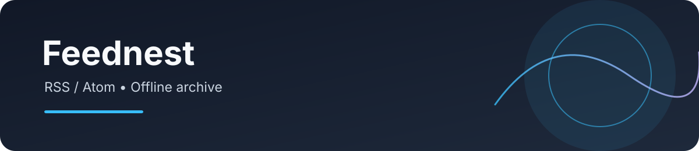

# FeedNest

<p align="center"></p>

**Your feeds. Your archive. Your machine.** An offline-first RSS/Atom reader that stores articles in SQLite for later search and reading.

## Features
- RSS 2.0 and Atom support
- Local SQLite cache; duplicate articles are ignored
- Read/unread state, search and feed removal
- Python standard library only — no pip install, account or server

## Run
Python 3.9+:

```bash
python app.py add https://planetpython.org/rss20.xml
python app.py refresh
python app.py list
python app.py read 1
python app.py search "python"
```

Use `python app.py --help` for commands. Data is stored in `feednest.db` beside the script. FeedNest contacts only URLs you explicitly subscribe to.